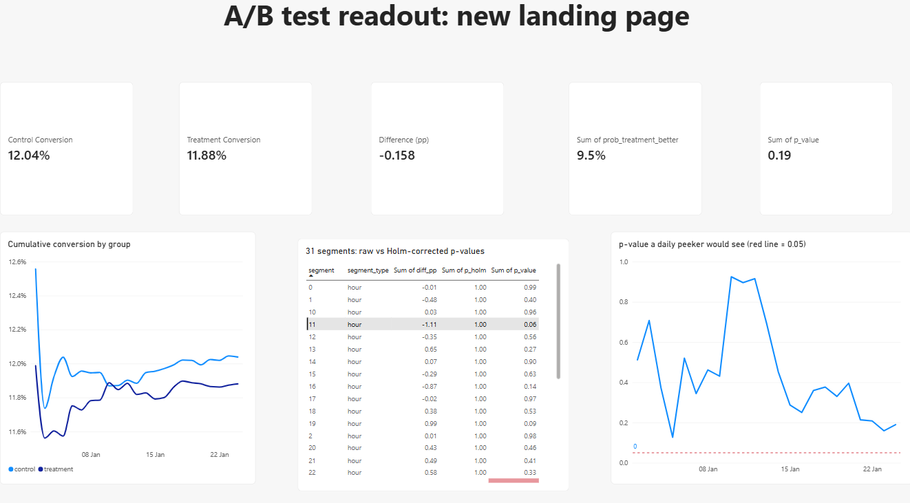
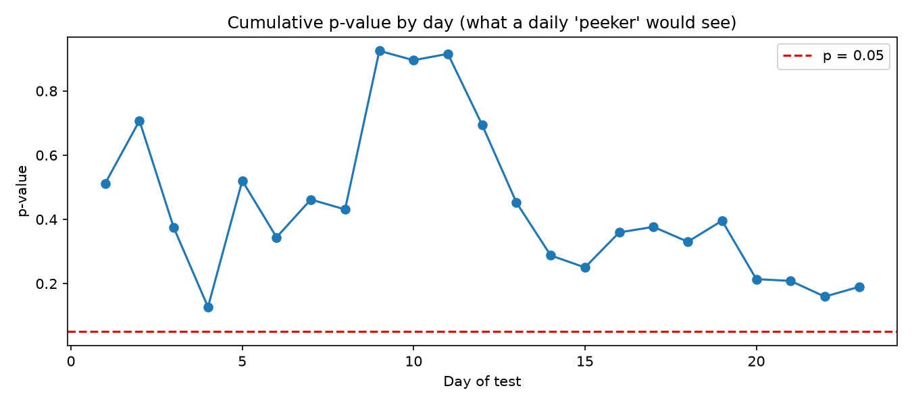
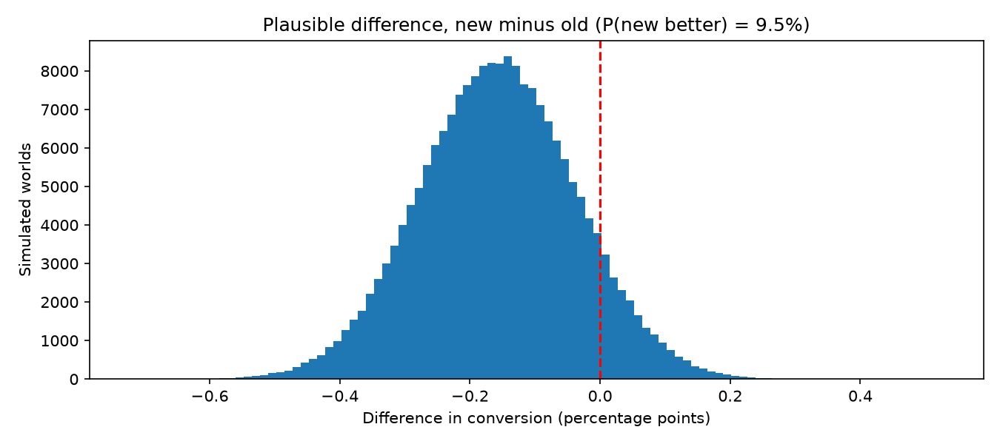
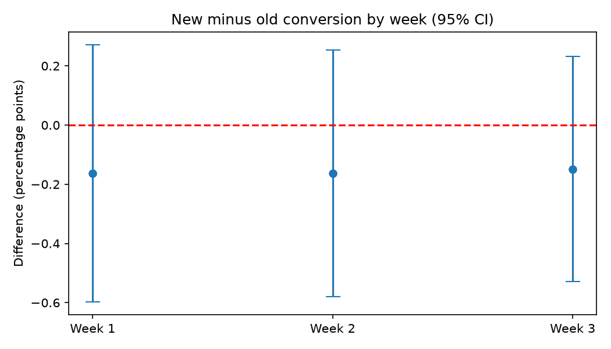

# A/B Test Decision Framework: from data bugs to a £ decision

**The decision:** keep the current landing page. Across **290,584 users**, the new page converted **11.88%** against **12.04%** for the old one. The 95% confidence interval runs from **−0.39 to +0.08 percentage points**, so even in the best case the upside is tiny. Shipping carries an expected regret of **£376k a year**, compared with **£12.5k** for keeping the current page.

The project goes well beyond "p < 0.05, ship it". It works through the questions an experimentation team at a fintech should ask before trusting a test result:

| Question | Answer |
|---|---|
| Is the data trustworthy? | **No, at first:** 3,893 users were shown *both* pages (an assignment bug). They were removed, leaving 290,584 users |
| Did the 50/50 split actually happen? | Yes: 50.006% treatment (SRM p = 0.95), and healthy on every one of the 23 days |
| Did the new page win? | No: −0.158 pp (−1.31% relative), p = 0.19, 95% CI −0.394 to +0.078 pp |
| Was the test big enough? | Yes: it could detect a **2.83%** relative lift with 80% power |
| What if someone had peeked daily? | Simulation: daily peeking at p < 0.05 gives a **false winner 22% of the time** |
| What's the chance the new page is better? | **9.5%** (Bayesian), with expected loss of 16.3 conversions per 10k users if shipped |
| Did it work for *some* users? | 4 of 31 segments looked significant; **0 survived** a Holm correction |
| Will users warm to it over time? | No: the gap was flat across weeks 1, 2 and 3 (no novelty effect) |
| What is each option worth? | Ship: **−£363k/yr** expected · Keep: £0 · Run 6 more months: −£91k |



---

## 1. Data quality: catching the assignment bug
Data: the public Kaggle *A/B Testing* dataset (294,478 rows, 2 to 24 January 2017).

- **3,893 rows** where the group and page didn't match (control users shown the new page, or the reverse). Every one of these belonged to a user who appeared twice, which means **users were exposed to both versions**.
- Those rows were removed rather than "corrected", because there's no way to know which page shaped the user's decision. One remaining duplicate user was also dropped.
- Final dataset: **290,584 users** (145,274 control / 145,310 treatment).

## 2. Sample ratio mismatch (SRM): run before looking at results
A chi-square test of the split against 50/50 gave **p = 0.947** overall. The daily split stayed between 49.3% and 50.6% (lowest daily p = 0.10). The alarm threshold is p < 0.001, so the test was valid to read.

## 3. The test

| | Control (old page) | Treatment (new page) |
|---|---|---|
| Users | 145,274 | 145,310 |
| Conversions | 17,489 | 17,264 |
| Conversion rate | **12.039%** | **11.881%** |

Difference **−0.158 pp** (−1.31% relative) · z = −1.31 · **p = 0.19** · **95% CI −0.394 to +0.078 pp**

A non-significant result doesn't mean the pages are the same. The confidence interval shows that **any real benefit is at most +0.08 pp (about +0.65%)**.

## 4. Power: was the test big enough?
With 145k users per group, the test had 80% power to detect a lift of **0.34 pp (2.83% relative)**.

| True relative lift | Power of this test | Users needed per group | Days needed |
|---|---|---|---|
| 1% | 16.9% | 1,151,908 | 182 |
| 2% | 51.0% | 289,207 | 46 |
| 3% | 84.4% | 129,081 | 20 |
| 5% | 99.9% | 46,859 | 7 |

So the test was well sized for any lift worth building, and chasing a 1% lift would take **6 months** of traffic.

## 5. The peeking trap



On the real data, the cumulative difference swung from −0.57 pp on day 1 to +0.02 pp on day 9 before settling at −0.16 pp. **2,000 simulated A/A tests** (identical pages, real traffic and baseline) show what daily peeking does:

| How the test is read | False "winners" |
|---|---|
| One look at the end | **3.8%** |
| Peek daily, stop at p < 0.05 | **22.4%** |
| Peek daily, stop at p < 0.01 | 5.8% |
| Peek daily, stop at p < 0.005 | 2.9% |

If daily looks are unavoidable, a threshold of about **p < 0.008** per look keeps false winners near 5%. This is the idea behind sequential testing.

## 6. Bayesian readout



With flat Beta(1,1) priors and 200,000 posterior draws:
- **P(new page better) = 9.5%**
- 95% credible interval: −0.393 to +0.080 pp (matching the frequentist CI)
- **Expected loss: ship 16.3 vs keep 0.5 conversions per 10,000 users**, so shipping carries about 33× more risk

## 7. The segment trap and novelty check
- **31 post-hoc segments** (24 hours + 7 weekdays) give an 80% chance of at least one false positive at p < 0.05. Four looked "significant" (4am, Saturday, 6am, 11pm, all *against* the new page), and **none survived a Holm correction**.
- **Novelty effect:** the weekly difference was −0.163, −0.163 and −0.149 pp, which is flat. Users didn't warm to the new page, so retesting later wouldn't change the result.



## 8. The decision in £
Illustrative assumptions: **£50 per conversion**, with traffic continuing at the observed ~12,600 users a day (4.6m a year).

| Option | Expected £ per year | 95% range | Expected regret |
|---|---|---|---|
| Ship new page | **−£363,131** | −£906,900 to +£184,099 | £375,658 |
| Keep current page | £0 | — | **£12,526** |
| Run 6 more months (to detect 1%) | −£90,534 (cost of the test) | — | — |

**Recommendation:** keep the current page, stop the test, and use the slot for a bolder change that could deliver a 3%+ lift. That's detectable in about 20 days at current traffic.

## 9. Reusable readout: `src/ab_readout.py`
The whole checklist is packaged into a single function, so every future test is read the same way:

```python
from src.ab_readout import ab_readout
result = ab_readout(df, group_col="group", metric_col="converted",
                    control="control", treatment="treatment",
                    value_per_conversion=50, annual_users=4_611_442)
```

It runs the SRM check, z-test, CI, power/MDE, Bayesian readout and £ impact, then returns a decision: **SHIP / DO NOT SHIP / KEEP CONTROL / INVALID (SRM)**. Notebook 09 shows it reproducing every figure above, and returning the right decision on two synthetic scenarios: a genuine winner (SHIP) and a broken split (INVALID).

## 10. Experiment design
[`EXPERIMENT_PLAN.md`](EXPERIMENT_PLAN.md) sets out how this test *should* have been planned: hypothesis, primary and guardrail metrics, MDE, sample size, duration, QA checks, stopping rules and decision rules agreed in advance. It ends with a comparison against what actually happened.

## 11. SQL
`10_sql_analysis.ipynb` reproduces the data-quality checks, SRM split, cumulative daily conversion (`SUM() OVER (PARTITION BY ... ORDER BY ...)`) and weekday segments (conditional aggregation) in SQL. All figures match Python.

---

## Repository structure
```
01_explore_clean.ipynb       assignment bug, duplicates, clean dataset
02_srm_check.ipynb           sample ratio mismatch, overall and daily
03_ab_test.ipynb             z-test, confidence interval, lift
04_power.ipynb               MDE, sample size and days by lift
05_peeking_trap.ipynb        real daily p-values + 2,000 A/A simulations
06_bayesian_readout.ipynb    P(better), credible interval, expected loss
07_segments_novelty.ipynb    31 segments with Holm correction, weekly effect
08_decision.ipynb            the three options in £
09_reusable_readout.ipynb    ab_readout() on real and synthetic tests
10_sql_analysis.ipynb        key checks reproduced in SQL
src/ab_readout.py            reusable readout function
EXPERIMENT_PLAN.md           pre-registration template + lessons
ab_test_readout.pbix         Power BI readout dashboard
outputs/                     charts and result tables
```
The raw file `ab_data.csv` isn't included. Download it from Kaggle (*A/B Testing*, Luyuan Zhang) into `data/raw/`, then run the notebooks in order.

**Tools:** Python (pandas, NumPy, SciPy, statsmodels, matplotlib), SQL (SQLite), Power BI (DAX).

## Limitations
- This is a public dataset with a single metric. There are no guardrail metrics (load time, bounce, complaints), and no user attributes such as new vs returning users or device.
- The £ value per conversion is an illustrative assumption.
- The peeking simulation assumes constant daily traffic and conversion. Real traffic has weekly cycles.
- The p < 0.008 daily threshold is a simple simulation-based correction, not a formal sequential design (e.g. O'Brien-Fleming or mSPRT).

## What I'd do with real company data
- Pre-register the plan before launch and add guardrail metrics.
- Use **CUPED** (pre-experiment behaviour as a covariate) to reduce variance, which can cut the sample size needed.
- Use a proper sequential testing framework if stakeholders need to monitor results live.
- Run pre-registered segment analysis (new vs returning, mobile vs desktop) for heterogeneous effects.
- Track long-term value (retention, product holding) rather than sign-up conversion alone.
